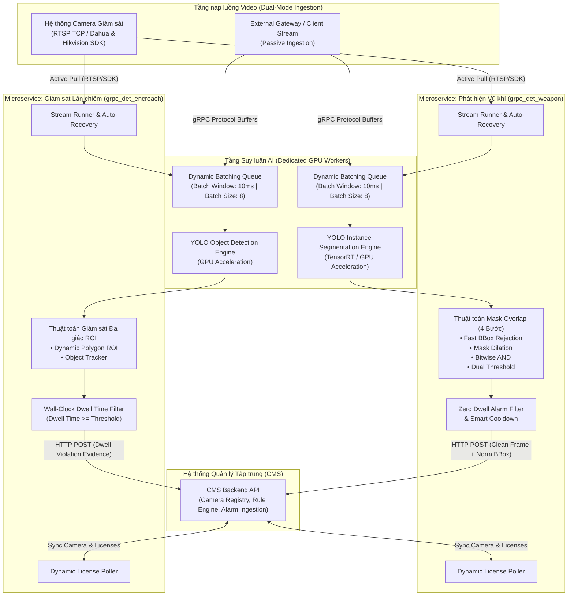

# 🛡️ Alarm AI Services — Real-time Security & Urban Vision System

Hệ thống phân tích hình ảnh giám sát an ninh thời gian thực dựa trên kiến trúc **Microservices & gRPC**, tích hợp công nghệ thị giác máy tính tiên tiến (**Computer Vision / Deep Learning**) nhằm giải quyết hai bài toán then chốt: **Phát hiện vũ khí nguy hiểm (Weapon Detection)** và **Giám sát vi phạm lấn chiếm không gian (Encroachment Monitoring)**.

---

## 📌 Điểm nổi bật của hệ thống

- ⚡ **Kiến trúc Microservices độc lập:** Phân tách ranh giới nghiệp vụ rõ ràng giữa tác vụ an ninh khẩn cấp (vũ khí) và trật tự đô thị (lấn chiếm), cho phép mở rộng phần cứng (GPU/CPU) linh hoạt theo từng tải trọng.
- 🎯 **Công nghệ Instance Segmentation chính xác cao:** Ứng dụng phân đoạn mặt nạ pixel thay vì bounding box thông thường, giải quyết triệt để bài toán góc nhìn phối cảnh gây báo động giả.
- 🧩 **Thuật toán Mask Overlap 4 bước:** Xác thực tương tác thực tế giữa người và vũ khí thông qua hình thái học (Morphological Dilation) và phép giao bitwise, loại bỏ báo động sai từ tranh ảnh hoặc vật dụng tĩnh.
- ⏱️ **Wall-Clock Dwell Time:** Đo thời gian chiếm dụng không gian theo đồng hồ thực của hệ điều hành, đảm bảo độ chính xác tuyệt đối ngay cả khi luồng camera sụt giảm FPS mạng.
- 🚀 **Dynamic Batching & Inference Optimization:** Tối ưu hóa throughput suy luận mô hình trên GPU, tự động gom cụm request và hủy bỏ tác vụ trễ hạn.
- 🔒 **Clean Evidence Standard:** Bảo toàn tính nguyên vẹn pháp lý của bằng chứng hình ảnh (không vẽ đè nét lên frame gốc, truyền tải kèm metadata tọa độ chuẩn hóa).

---

## 🏗️ Sơ đồ kiến trúc tổng quan



---

## 🛠️ Công nghệ cốt lõi

### 1. Thị giác máy tính & Mô hình AI (AI / Computer Vision)
- **YOLO Instance Segmentation (YOLOv8-seg):** Dự đoán đồng thời bounding box và mặt nạ phân đoạn đối tượng (pixel-level binary mask) cho cả lớp người và các loại vũ khí mục tiêu.
- **YOLO Object Detection:** Nhận diện và phân loại phương tiện, bàn ghế, vật dụng lấn chiếm trong các khu vực đô thị.
- **Deep Learning Inference Acceleration:** Hỗ trợ tối ưu hóa trọng số mô hình qua TensorRT FP16 Engine, nâng cao throughput và giảm độ trễ xử lý per-frame.
- **OpenCV (C++/Python bindings):** Xử lý ma trận hình ảnh, phép toán hình thái học (Morphological Operations: Dilation, Erosion), kiểm tra hình học đa giác (`cv2.pointPolygonTest`).

### 2. Giao tiếp liên dịch vụ & Mạng (Networking & Microservices)
- **gRPC over HTTP/2:** Giao tiếp RPC nhị phân tốc độ cao giữa các thành phần client và worker, tối ưu hóa băng thông truyền tải mảng byte ảnh.
- **Protocol Buffers (Protobuf v3):** Định nghĩa cấu trúc hợp đồng dữ liệu chuẩn hóa (`detector.proto`) với khả năng tương thích ngược và kiểm tra kiểu tĩnh nghiêm ngặt.
- **Dual-Mode Video Ingestion:**
  - *Chủ động (Active Ingestion):* Tự động kết nối camera qua RTSP với cơ chế ép truyền dẫn TCP (`rtsp_transport;tcp`) chống suy hao gói mạng. Tích hợp trực tiếp Native C-SDKs của các hãng sản xuất thiết bị giám sát.
  - *Thụ động (Passive Ingestion):* Tiếp nhận luồng frame nhị phân trực tiếp từ các gateway bên ngoài thông qua gRPC endpoints.

### 3. Tối ưu hóa xử lý & Đồng thời (Concurrency & Systems Engineering)
- **Sliding Window Dynamic Batching:** Gom nhiều request suy luận thành một batch duy nhất trong cửa sổ mili-giây, tận dụng tối đa kiến trúc xử lý song song của GPU.
- **Dead Request Cancellation:** Kiểm tra tính khả dụng của kết nối (`ctx.is_active()`) trước khi nạp batch vào GPU, loại bỏ request quá hạn và chống nghẽn hàng đợi khi chịu tải cao.
- **Asynchronous Event Dispatching:** Sử dụng mô hình xử lý đa luồng (Worker Thread Pools) để gửi cảnh báo và dữ liệu bằng chứng về hệ thống quản lý, tách biệt hoàn toàn I/O mạng khỏi vòng lặp xử lý video nóng.
- **Self-Healing Architecture:** Cơ chế phát hiện ngắt kết nối mạng và tự phục hồi (Automatic Reconnection) theo chu kỳ, duy trì độ sẵn sàng cao của hệ thống giám sát 24/7.

---

## 🔄 Luồng xử lý chi tiết (Processing Pipelines)

### 1. Luồng phát hiện vũ khí & Xác thực nguy cơ (Weapon Detection Pipeline)

Hệ thống vũ khí được thiết kế theo tiêu chí **Zero False Alarm** đối với các vật thể tĩnh và **Zero Dwell Time** (báo động tức thì khi có mối đe dọa thực tế).

```
[Camera Stream / gRPC Input]
            │
            ▼
┌───────────────────────────────┐
│     YOLOv8-seg Inference      │ ──> Trả về BBox & Mask cho Person và Weapon
└──────────────┬────────────────┘
            │
            ▼
┌───────────────────────────────┐
│ Bước 1: Fast BBox Rejection   │ ──> Kiểm tra giao nhau sơ bộ giữa Person & Weapon
└──────────────┬────────────────┘     (Bỏ qua 95% frame không giao thoa để tiết kiệm tài nguyên)
            │ [Box Intersects]
            ▼
┌───────────────────────────────┐
│ Bước 2: Morphological Dilation│ ──> Làm nở mặt nạ Người (Dilation Kernel: 5–15px)
└──────────────┬────────────────┘     để bù đắp vùng tiếp xúc ở bàn tay, ngón tay
            │
            ▼
┌───────────────────────────────┐
│ Bước 3: Bitwise AND Overlap   │ ──> Overlap_Mask = Dilated_Person_Mask & Weapon_Mask
└──────────────┬────────────────┘
            │
            ▼
┌───────────────────────────────┐
│ Bước 4: Dual-Threshold Verify │ ──> Kiểm tra diện tích giao (>= MIN_PIXELS)
└──────────────┬────────────────┘     và tỷ lệ diện tích (>= MIN_RATIO)
            │ [Xác nhận có tương tác]
            ▼
┌───────────────────────────────┐
│ Bộ lọc Cảnh báo Thông minh    │ ──> Ẩn hoàn toàn class Người, chỉ trích xuất thông tin Vũ khí;
│  & Smart Cooldown Engine      │     Kiểm tra Cooldown thời gian theo từng Camera ID
└──────────────┬────────────────┘
            │
            ▼
[Gửi Clean Evidence: Ảnh gốc + Metadata chuẩn hóa lên CMS]
```

### 2. Luồng giám sát vi phạm lấn chiếm (Urban Encroachment Pipeline)

Hệ thống lấn chiếm giải quyết bài toán giám sát vỉa hè và khu vực cấm thông qua ranh giới đa giác tùy biến.

```
[Camera Stream / gRPC Input]
            │
            ▼
┌───────────────────────────────┐
│ Dynamic Polygon ROI Parsing   │ ──> Nhận diện vùng giám sát đa giác tùy biến từ CMS UI;
└──────────────┬────────────────┘     Hỗ trợ linh hoạt cả tọa độ chuẩn hóa và tọa độ pixel
            │
            ▼
┌───────────────────────────────┐
│    Object Detection Model     │ ──> Phát hiện các đối tượng mục tiêu (xe cộ, bàn ghế, đồ đạc...)
└──────────────┬────────────────┘
            │
            ▼
┌───────────────────────────────┐
│ Polygon Spatial Intersection  │ ──> cv2.pointPolygonTest kiểm tra tâm/đáy của đối tượng
└──────────────┬────────────────┘     nằm bên trong hay bên ngoài ranh giới đa giác
            │ [Đối tượng ở trong ROI]
            ▼
┌───────────────────────────────┐
│  Track Lifecycle Management   │ ──> Khởi tạo / cập nhật vết đối tượng (Track ID)
└──────────────┬────────────────┘
            │
            ▼
┌───────────────────────────────┐
│ Wall-Clock Dwell Time Check   │ ──> Tính toán thời gian chiếm dụng theo time.monotonic()
└──────────────┬────────────────┘     Dwell_Time = current_time - roi_since >= DWELL_THRESHOLD
            │ [Đạt ngưỡng vi phạm]
            ▼
[Kích hoạt Cảnh báo Vi phạm & Gửi dữ liệu bằng chứng về CMS]
```

---

## ⚖️ Tiêu chuẩn Bằng chứng số nguyên vẹn (Clean Evidence Architecture)

Một nguyên tắc cốt lõi trong toàn bộ hệ thống là **bảo toàn tính pháp lý và tính nguyên bản của dữ liệu**:
- **Không vẽ trực tiếp lên frame gốc:** Hệ thống tuyệt đối không burn-in bounding box, nhãn hay nét vẽ phân đoạn lên frame ảnh trước khi gửi về backend.
- **Tách biệt dữ liệu và giao diện:** Cảnh báo được gửi dưới dạng ảnh gốc chất lượng cao kèm metadata tọa độ đã được chuẩn hóa ($[0.0, 1.0]$) cùng các thông số đánh giá (confidence, overlap ratio, dwell time).
- **Lợi ích thực tiễn:** Cho phép hệ thống quản lý tập trung (CMS) linh hoạt bật/tắt lớp đồ họa hiển thị trên Web/App mà không làm biến dạng bằng chứng pháp lý gốc.
